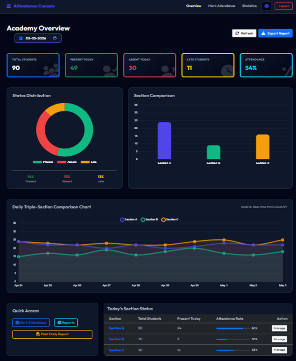
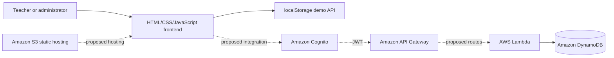

# Cloud Guard — Attendance Management System

A responsive attendance portal prototype for managing class rosters, recording daily attendance, and viewing attendance summaries. The repository includes a browser-based demo and documentation for a proposed AWS serverless architecture.

> **Project status:** The checked-in application is a frontend demo. Login and attendance data are simulated in the browser and saved to `localStorage`. AWS Cognito, API Gateway, Lambda, DynamoDB, and S3 are described as a proposed architecture; backend functions, infrastructure-as-code, and a live AWS deployment are not included in this repository.



[Login screen](assets/screenshots/login.png) · [Proposed system architecture](assets/architecture/proposed-system-architecture.png)

## Features

- Login screen with selectable teacher/admin demo roles
- Class and student views, attendance marking, and CSV export
- Dashboard cards, attendance summaries, and charts
- Light and dark theme toggle
- Browser-local demo persistence with sample data
- Architecture, API, database, and deployment planning documents

## Run the demo

**Requirements:** Node.js and npm.

```bash
git clone https://github.com/hemanthg-10/cloud-guard-attendance-management-system.git
cd cloud-guard-attendance-management-system
npm install --prefix frontend
npm run dev --prefix frontend
```

Open the local URL printed by Vite (normally `http://localhost:5173`). For this demo, enter any non-empty email and password and choose a role. This form does not authenticate against Cognito or a server. Do not enter real credentials or real student information.

Attendance and theme changes are stored in the current browser's `localStorage`; they are not shared between users or devices and may be cleared by the browser.

## Technology and skills

- **Frontend:** HTML5, CSS3, JavaScript (ES6+), Bootstrap 5
- **Development tooling:** Vite, npm
- **Cloud architecture concepts documented:** AWS Cognito, API Gateway, Lambda, DynamoDB, and S3
- **Skills demonstrated:** responsive interface design, client-side state handling, attendance workflows, dashboard visualization, API contract documentation, and serverless architecture planning

The AWS services above describe the design proposal; they are not active integrations in the current demo.

## Architecture

The diagram below is the proposed target architecture. The running project currently uses a browser-local mock API in `frontend/js/api.js`.



## Repository layout

```text
frontend/                 Login, dashboard, attendance, class, admin, and stats pages
frontend/js/              Demo API, UI behavior, and sample student data
frontend/css/             Application styles
frontend/register/        Attendance register workflow
assets/screenshots/       Login and dashboard screenshots
assets/architecture/      Proposed architecture diagram
docs/                     Architecture, API, schema, deployment, report, references
```

## Documentation

- [Architecture](docs/architecture.md)
- [API contract](docs/api-documentation.md) — proposed interface, not a deployed API
- [Database schema](docs/database-schema.md) — proposed DynamoDB design
- [AWS services](docs/aws-services.md)
- [Deployment plan](docs/deployment.md) — prerequisites and implementation work remain
- [Research references](docs/research/references.md)
- [Project report](docs/report/cloud-guard-project-report-redacted.pdf) — public copy with author names and student IDs redacted

## Research references

The background papers are cited and linked in [Research references](docs/research/references.md). Publisher PDFs are not redistributed in this repository. The cited work informed the project background; this prototype does not implement the papers' crowdsensing, smartphone sensing, or facial recognition methods.

## Limitations and next steps

- Replace the mock API and browser-only login with a real backend and secure authentication.
- Implement and deploy the proposed Lambda functions, API routes, DynamoDB tables, and least-privilege IAM policies.
- Add automated checks and validate accessibility, error handling, and security before production use.
- Replace synthetic records with authorized data only in a properly secured environment.

This project is an academic prototype and is not suitable for production attendance records in its current form.

## License

The source code is provided under the [MIT License](LICENSE). Research papers remain subject to their publishers' terms and are linked for reference only.

## Author

**Hemanth G** — B.E. Computer Science and Engineering, Mahendra Engineering College.
