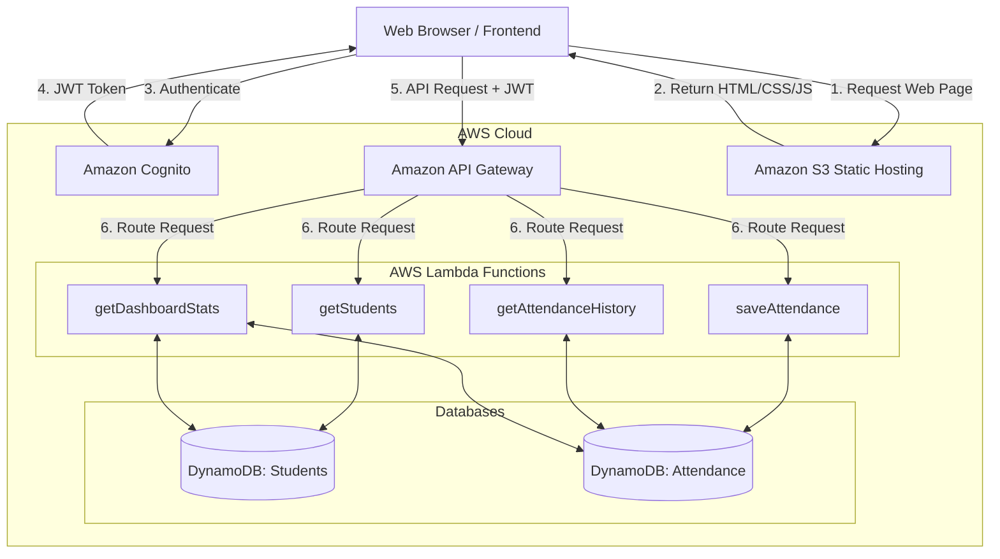

> **Status:** Target design only. The repository currently contains a browser-only frontend demo; it does not include deployed AWS services or the Lambda backend described below.

# Cloud Guard Architecture

This document describes the high-level architecture and data flow for the Cloud Guard Serverless Attendance System.

## Overall Architecture

The architecture is built completely using AWS Serverless technologies.

## Request Flows

### 1. Authentication Flow
- The frontend redirects unauthenticated users to the Login page.
- User submits email/password.
- Frontend uses AWS SDK / Cognito Identity Provider to authenticate.
- On success, Cognito returns an ID Token, Access Token, and Refresh Token.
- Tokens are stored locally (`localStorage` or `sessionStorage`).
- API Gateway uses a Cognito User Pool Authorizer to validate the ID token on every API request.

### 2. Attendance Marking Flow
- The user selects a Class/Section and Date.
- Frontend calls `GET /students?section={id}` to populate the roster.
- API Gateway triggers the `getStudents` Lambda.
- Lambda queries the `Students` DynamoDB table and returns the list.
- Teacher marks P/A/L (Present/Absent/Late) and clicks "Save".
- Frontend sends a `POST /attendance` request with the array of records.
- API Gateway triggers `saveAttendance` Lambda.
- Lambda iterates and performs a `BatchWriteItem` or `PutItem` loop into the `Attendance` DynamoDB table.

### 3. Dashboard Retrieval Flow
- On dashboard load, the frontend calls `GET /dashboard/stats`.
- The `getDashboardStats` Lambda scans or queries recent records in the `Attendance` table and counts totals for the active date.
- It calculates percentages and returns a consolidated JSON object to the frontend for rendering charts and metric cards.

## AWS Service Responsibilities
- **Amazon S3**: Hosts the static Vite/React/HTML bundle for low-latency global delivery.
- **Amazon Cognito**: Handles password policies, brute-force protection, and secure JWT issuance.
- **Amazon API Gateway**: Acts as the single entry point for backend logic. It enforces CORS, rate limiting, and JWT validation.
- **AWS Lambda**: Executes stateless business logic, converting API inputs into database queries.
- **Amazon DynamoDB**: Provides single-digit millisecond latency for querying students by section and attendance by date.
